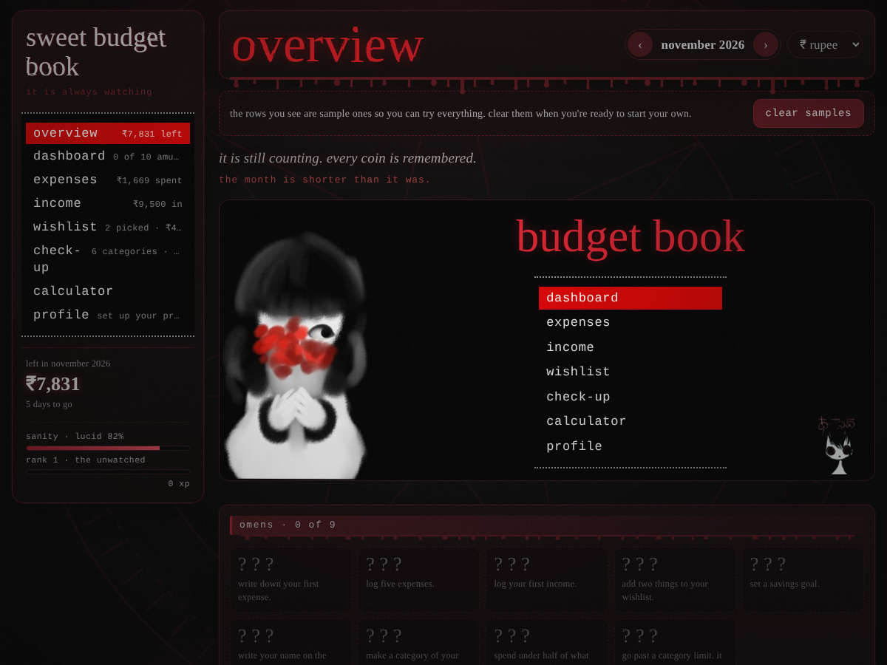
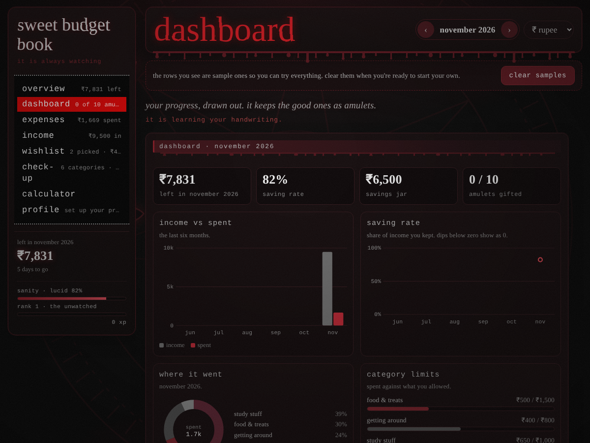

<div align="center">


<br>


**a haunted little budget tracker. every coin is remembered.**

[**Deploy to Vercel**](https://vercel.com/new/clone?repository-url=https://github.com/YOUR-USERNAME/sweet-budget-book) &nbsp;·&nbsp; [Features](#-features) &nbsp;·&nbsp; [Structure](#-project-structure) &nbsp;·&nbsp; [Run locally](#-run-locally) &nbsp;·&nbsp; [Deploy](#-deploy-on-vercel)


</div>

## 🩸 About

**Sweet Budget Book** tracks your money: expenses, income, a wishlist, savings goals, and a calculator. All of it wears a creepy skin. It is a plain static site (HTML, CSS and vanilla JavaScript), with **no framework, no build step and no backend**. Your data is saved in your browser's `localStorage` and never leaves your device.

<div align="center">

</div>


## 🕯️ Features

| | |
|---|---|
| 💸 **Expenses & income** | Log by day and category, tap a day in the calendar to filter, month-by-month navigation. |
| 🎁 **Wishlist** | Pick what you want, see the total, and check whether you can afford it. A floating calculator is built in. |
| 🧮 **Calculator** | Full calculator page with keyboard support, a *recent* list you can reuse or **clear**, and "add to expenses" in one tap. |
| 🩺 **Check-up** | Monthly category limits (rename, recolour, delete) and multiple savings goals. |
| 📊 **Dashboard** | Six-month income vs spent, saving-rate trend, category donut, limit usage and goal progress, all drawn as inline SVG. |
| 🧿 **Amulets** | Gifted automatically for real progress (see below). |
| 👁️ **Omens & sanity** | Achievements, ranks and a sanity meter that drops as your budget does. |
| 👻 **Hauntings** | Claw gashes and shattering calculator keys, and a *very rare* ghost jumpscare with a synthesized buzzing sound. |

<div align="center">

</div>

### 🧿 Amulets

Amulets only count **your own** entries. The pre-filled sample rows don't count. Once earned they are kept.

| Amulet | How to earn it |
|---|---|
| the first thread | log 10 of your own expenses |
| the tally keeper | log 30 expenses |
| seven nights awake | log spending on 7 different days |
| the long vigil | log expenses in 3 different months |
| the quiet vessel | keep 30% of a month's income |
| ward of bounds | stay inside every category limit in a month with 5+ expenses |
| the steady scale | two months in a row where income covered spending |
| the half-filled jar | bring a savings goal to 50% |
| the sealed vow | finish a savings goal |
| the black coin | hold 10,000 in your savings jar |

### 👻 The jumpscare

It lives on the **calculator page only** and is deliberately rare: at least 6 key presses first, then about a 3% chance per press, with a 4-minute cooldown that survives reloads. Tune it in [`js/effects/jumpscare.js`](js/effects/jumpscare.js):

```js
var SCARE_COOLDOWN = 4 * 60 * 1000, SCARE_CHANCE = .03, SCARE_MIN_PRESSES = 6;
```


## 🦴 Project structure

```text
sweet-budget-book/
├── index.html                  # markup + <link>/<script> tags (script order matters)
├── vercel.json                 # static deploy config + headers
├── package.json                # optional: `npm start` serves the folder
├── assets/
│   ├── banner.svg  divider.svg # README art
│   ├── icon-192.png  apple-touch-icon.png
│   └── screenshots/
├── css/
│   ├── base.css                # tokens, reset, layout basics
│   ├── header.css  cards.css  sidebar.css  rail.css  panels.css
│   ├── calculator.css  calculator-recents.css  floating-calculator.css
│   ├── checkup.css  calendar.css  shell.css  dashboard.css
│   ├── theme-ledger.css  theme-haunted.css  sidebar-menu.css
│   └── haunted-calculator.css  jumpscare.css
└── js/
    ├── data/images.js          # embedded artwork (base64)
    ├── core/                   # constants, helpers, state, storage
    ├── ui/                     # header, cards, rail, panels, calendar, todos,
    │                           #   floating-calculator, nav-config, navigation, render
    ├── pages/                  # expenses, income, wishlist, calculator,
    │                           #   profile, checkup, dashboard
    ├── game/omens.js           # omens, ranks, sanity
    ├── effects/                # jumpscare, haunted-calculator, whispers-eyes, app-icons
    └── main.js                 # start-up, must load last
```

> **Heads up:** scripts are classic (non-module) files that share one global scope, so the book still works when you open `index.html` straight from disk. Keep the `<script>` order in `index.html` as is, and add new files above `main.js`. CSS order matters too, because later files override earlier ones.


## 🔪 Run locally

No install needed. Either double-click `index.html`, or serve the folder:

```bash
npx serve .
# or
python3 -m http.server 8000
```

Then open the printed address.

## ☠️ Deploy on Vercel

This is a static site, so Vercel needs no build.

**One click:** click **Deploy to Vercel** at the top (replace `YOUR-USERNAME` in the link with your GitHub username once the repo exists).

**From the dashboard**

1. Push this folder to a GitHub repo.
2. On [vercel.com/new](https://vercel.com/new), import the repo.
3. Leave **Framework Preset** as *Other*, with no build command and no output directory change. `vercel.json` already sets `"outputDirectory": "."`.
4. Click **Deploy**.

**From the CLI**

```bash
npm i -g vercel
vercel          # preview
vercel --prod   # production
```

`vercel.json` also adds basic security headers and makes sure HTML, CSS and JS are revalidated on each deploy, so updates show up straight away.

## 🕸️ Notes

- **Your data is local.** It is stored per browser and per site address, so a Vercel domain starts empty even if you used the file locally. There is no sync between devices.
- **Fonts** load from Google Fonts (IM Fell English, EB Garamond, Special Elite, Reenie Beanie). Offline, it falls back to system serif and monospace fonts.
- **Sound** (jumpscare) is synthesized with the Web Audio API and only plays after you interact with the page. Browsers block audio before that.
- **Photosensitivity:** the jumpscare includes a brief flash and shaking. With the OS "reduce motion" setting on, the animation is shortened.

<div align="center">


<sub>MIT licensed · made to be a little bit unsettling</sub>

</div>
